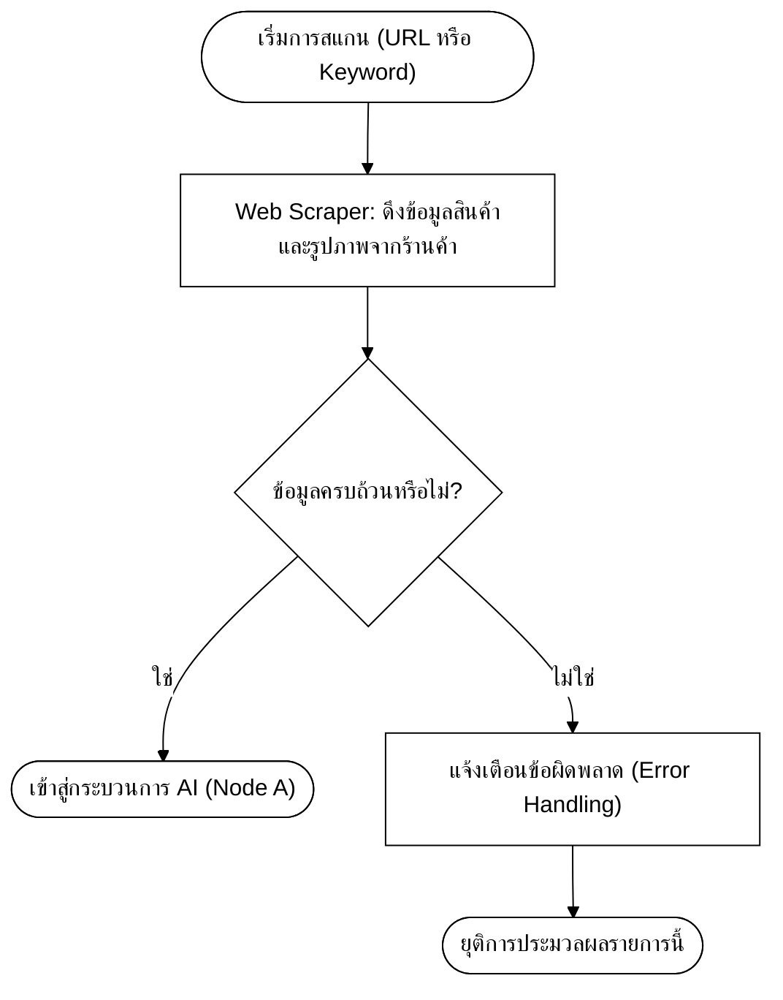
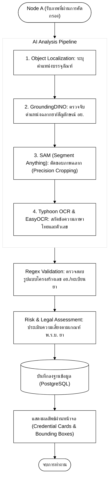
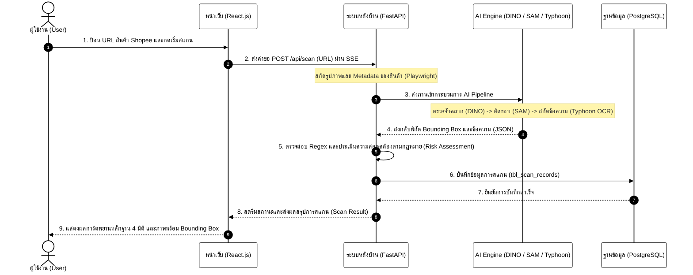
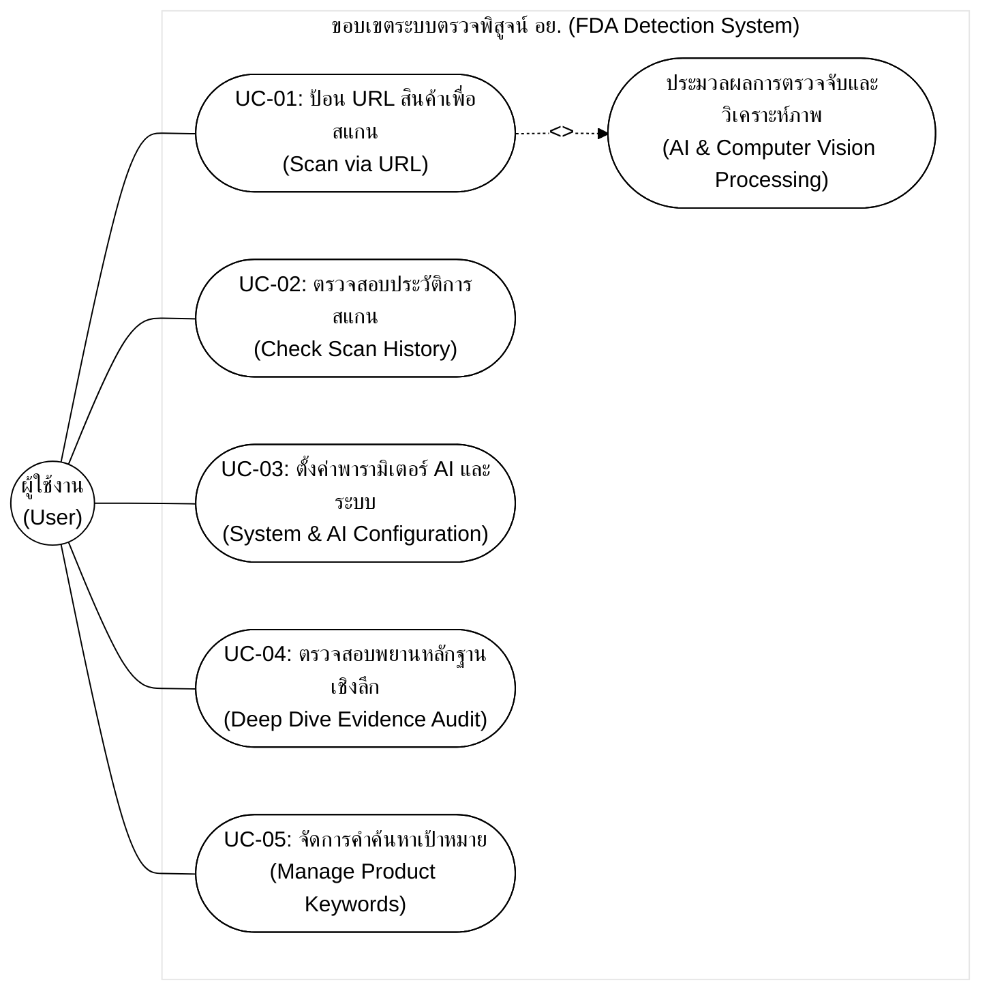
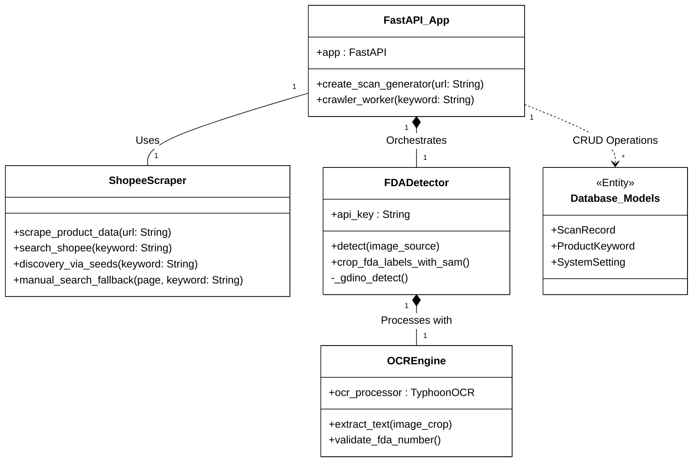
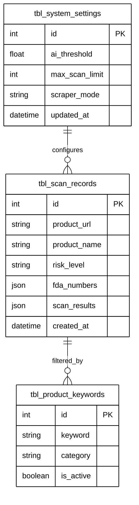

# บทที่ 3  
# ขั้นตอนการดำเนินงาน

&nbsp;&nbsp;&nbsp;&nbsp;&nbsp;&nbsp;&nbsp;&nbsp;ในการพัฒนาระบบตรวจจับและตรวจสอบข้อความบนฉลากยาของแพลตฟอร์มซื้อขายออนไลน์ (Label Text Detection and Verification System for Online Trading Platforms) ผู้ศึกษาได้กำหนดขั้นตอนและระเบียบวิธีในการดำเนินงานอย่างเป็นระบบ เพื่อให้สามารถวิเคราะห์และคัดกรองผลิตภัณฑ์ยาและเวชภัณฑ์บนแพลตฟอร์มอีคอมเมิร์ซได้อย่างมีประสิทธิภาพ โดยมีรายละเอียดขั้นตอนการดำเนินงาน ดังต่อไปนี้

---

## 3.1 รายละเอียดโครงการ (Project Overview)

&nbsp;&nbsp;&nbsp;&nbsp;&nbsp;&nbsp;&nbsp;&nbsp;ระบบตรวจสอบผลิตภัณฑ์สุขภาพ (FDA Detection System) พัฒนาขึ้นเพื่อแก้ปัญหาการลักลอบจำหน่ายยาปลอม ยาไม่มีเลขทะเบียนตำรับยา และผลิตภัณฑ์ที่ไม่มีฉลากภาษาไทยตามที่พระราชบัญญัติยา พ.ศ. 2510 กำหนด โดยระบบทำงานในลักษณะ Multi-stage AI Pipeline ประกอบด้วย:
1. **ระบบการดึงข้อมูล (Data Acquisition Layer) :** สกัดรูปภาพและข้อมูลรายละเอียดสินค้า (Metadata) จากแพลตฟอร์ม Shopee โดยใช้ Playwright ร่วมกับเทคนิคการป้องกันการตรวจจับบอท (Stealth Browsing)
2. **ระบบการตรวจจับและตัดขอบภาพ (Detection & Cropping Layer) :** ใช้สถาปัตยกรรม GroundingDINO ในการระบุพิกัดฉลากยาหรือสัญลักษณ์ อย. ด้วยคำสั่งข้อความ (Text Prompt) และใช้ Segment Anything Model (SAM) ในการตัดขอบภาพเฉพาะส่วนของฉลากยาอย่างแม่นยำ (Precision Cropping)
3. **ระบบการรู้จำข้อความและการตรวจสอบความถูกต้อง (OCR & Validation Engine) :** ใช้โมเดลภาษาขนาดใหญ่ Typhoon OCR สำหรับอ่านข้อความภาษาไทยที่มีความละเอียดซับซ้อน และใช้นิพจน์ปกติ (Regular Expression) ในการตรวจสอบรูปแบบโครงสร้างเลขทะเบียนตำรับยาและเลข อย.
4. **ระบบการประเมินความสอดคล้องตามกฎหมาย (Explainable Assessment Layer) :** ประเมินระดับความเสี่ยงและจับคู่ข้อผิดพลาดกับมาตราใน พ.ร.บ. ยา พ.ศ. 2510
5. **ระบบส่วนติดต่อผู้ใช้งาน (User Interface & Presentation Layer) :** พัฒนาด้วย React.js และ Tailwind CSS เพื่อแสดงผลลัพธ์ในรูปแบบการ์ดพยานหลักฐาน 4 มิติ (Credential Cards) และรองรับการสตรีมสถานะแบบเรียลไทม์ด้วย Server-Sent Events (SSE)

---

## 3.2 ขั้นตอนการดำเนินงาน (Workflow Diagrams)

### 3.2.1 แผนภาพตรรกะการประมวลผล (AI Processing Flowchart)
กระบวนการวิเคราะห์ภาพแบ่งออกเป็น 2 ส่วนหลัก ได้แก่ การเตรียมข้อมูลและการคัดกรองเบื้องต้น และส่วนการวิเคราะห์เชิงลึกด้วย Multi-stage AI Pipeline

#### ส่วนที่ 1: การเตรียมข้อมูลและการตรวจสอบเงื่อนไขเบื้องต้น (Data Preparation and Initial Validation)

<b>ภาพที่ 3.1</b> แผนภาพตรรกะการประมวลผลส่วนที่ 1: การเตรียมข้อมูลและคัดกรองเบื้องต้น

 

#### ส่วนที่ 2: ขั้นตอนการวิเคราะห์เชิงลึกด้วย AI และการแสดงผล (AI Analysis Pipeline & Output)

<b>ภาพที่ 3.2</b> แผนภาพตรรกะการประมวลผลส่วนที่ 2: ขั้นตอนการวิเคราะห์เชิงลึกด้วย AI และการแสดงผล

---

### 3.2.2 แผนภาพลำดับขั้นตอนการทำงานของระบบ (System Sequence Diagram)

&nbsp;&nbsp;&nbsp;&nbsp;&nbsp;&nbsp;&nbsp;&nbsp;แผนภาพลำดับการทำงานแสดงการส่งผ่านข้อมูลและการติดต่อสื่อสารระหว่างแต่ละส่วนประกอบของระบบ ได้แก่ ผู้ใช้งาน (User), หน้าเว็บ (React.js), ระบบหลังบ้าน (FastAPI), ปัญญาประดิษฐ์ (AI Engine) และฐานข้อมูล (PostgreSQL)

<b>ภาพที่ 3.3</b> แผนภาพลำดับขั้นตอนการทำงานของระบบ (System Sequence Diagram)

---

## 3.3 แผนภาพแสดงฟังก์ชันการทำงานของระบบ (Use Case Diagram)

&nbsp;&nbsp;&nbsp;&nbsp;&nbsp;&nbsp;&nbsp;&nbsp;ระบบถูกออกแบบขึ้นในลักษณะเครื่องมือวิเคราะห์แบบเปิด (Open-Access Audit Tool) โดยกำหนดให้มี **ผู้ใช้งานระบบ (User)** เป็น Actor หลักเพียงหนึ่งเดียว สามารถเข้าถึงฟังก์ชันการทำงานทั้งหมดของระบบได้โดยตรง

<b>ภาพที่ 3.4</b> แผนภาพแสดงฟังก์ชันการทำงานของระบบ (Use Case Diagram)

---

## 3.4 คำอธิบายรายละเอียดของยูสเคส (Use Case Description)

### ตารางที่ 3.1 Use Case Description: UC-01 ป้อน URL สินค้าเพื่อสแกน (Scan via URL)
| หัวข้อ | รายละเอียด |
| :--- | :--- |
| **รหัสยูสเคส (Use Case ID)** | UC-01 |
| **ชื่อยูสเคส (Use Case Name)** | ป้อน URL สินค้าเพื่อสแกน (Scan via URL) |
| **ผู้กระทำ (Actor)** | ผู้ใช้งานระบบ (User) |
| **คำอธิบาย (Description)** | ผู้ใช้งานระบุ URL สินค้าจาก Shopee เพื่อให้ระบบสกัดภาพสินค้า ส่งต่อให้ AI ตรวจจับฉลาก สกัดข้อความ และประเมินความสอดคล้องตามกฎหมาย |
| **เงื่อนไขก่อนเริ่มทำงาน (Preconditions)** | 1. ผู้ใช้เข้าถึงหน้าเว็บของระบบได้ 2. ระบบหลังบ้าน (FastAPI) และโมเดล AI พร้อมให้บริการ |
| **สิ่งกระตุ้น (Trigger)** | ผู้ใช้กดปุ่ม "เริ่มวิเคราะห์สินค้า" |
| **ลำดับขั้นตอนการทำงานปกติ (Normal Flow)** | 1. ผู้ใช้ป้อน URL สินค้าลงในช่องค้นหาและกดยืนยัน 2. ระบบตรวจสอบความถูกต้องของรูปแบบ URL 3. ระบบหลังบ้านดึงข้อมูลรูปภาพและรายละเอียดจากแพลตฟอร์ม Shopee 4. ระบบส่งภาพเข้าสู่ AI Analysis Pipeline (DINO, SAM, Typhoon OCR) 5. ระบบตรวจจับรูปแบบเลขทะเบียนด้วย Regex และประเมินความเสี่ยง 6. ระบบส่งสถานะแบบเรียลไทม์ และแสดงผลการ์ดพยานหลักฐาน 4 มิติบนหน้าจอ |
| **ลำดับขั้นตอนทางเลือก (Alternative Flow)** | 1a. หาก URL ไม่ถูกต้อง ระบบจะแสดงข้อความแจ้งเตือนให้ระบุ URL ใหม่ 3a. หาก Shopee บล็อกการดึงข้อมูล ระบบจะสลับไปใช้โหมดสำรอง (Fallback Mode) 4a. หากประมวลผล AI ล้มเหลว ระบบจะบันทึกสถานะข้อผิดพลาดและแจ้งเตือนผู้ใช้ |
| **เงื่อนไขหลังสิ้นสุดการทำงาน (Postconditions)** | ผลการวิเคราะห์ พิกัดกรอบรูปภาพ และระดับความเสี่ยง ถูกบันทึกลงในตาราง `tbl_scan_records` |

 

### ตารางที่ 3.2 Use Case Description: UC-02 ตรวจสอบประวัติการสแกน (Check Scan History)
| หัวข้อ | รายละเอียด |
| :--- | :--- |
| **รหัสยูสเคส (Use Case ID)** | UC-02 |
| **ชื่อยูสเคส (Use Case Name)** | ตรวจสอบประวัติการสแกน (Check Scan History) |
| **ผู้กระทำ (Actor)** | ผู้ใช้งานระบบ (User) |
| **คำอธิบาย (Description)** | ผู้ใช้เรียกดูรายการสินค้าที่เคยผ่านการตรวจสอบในอดีต พร้อมทั้งสถิติภาพรวมและการแจกแจงระดับความเสี่ยง |
| **เงื่อนไขก่อนเริ่มทำงาน (Preconditions)** | มีข้อมูลประวัติการสแกนบันทึกอยู่ในฐานข้อมูล |
| **สิ่งกระตุ้น (Trigger)** | ผู้ใช้เลือกเมนู "สรุปภาพรวม" หรือส่วนประวัติการตรวจสอบ |
| **ลำดับขั้นตอนการทำงานปกติ (Normal Flow)** | 1. ผู้ใช้เข้าสู่หน้ารายการประวัติการตรวจสอบ 2. ระบบดึงข้อมูลรายการสแกนทั้งหมดจากตาราง `tbl_scan_records` 3. ระบบแสดงผลสรุปสถิติ กราฟการกระจายตัวของประเภทสินค้า และตารางรายการสินค้า |
| **ลำดับขั้นตอนทางเลือก (Alternative Flow)** | 2a. หากยังไม่มีข้อมูลประวัติในระบบ ระบบจะแสดงข้อความ "ไม่พบข้อมูลประวัติการตรวจสอบ" |
| **เงื่อนไขหลังสิ้นสุดการทำงาน (Postconditions)** | ผู้ใช้สามารถคลิกเลือกรายการที่ต้องการเพื่อเปิดดูรายละเอียดพยานหลักฐานย้อนหลังได้ |

 

### ตารางที่ 3.3 Use Case Description: UC-03 ตั้งค่าพารามิเตอร์ AI และระบบ (System Configuration)
| หัวข้อ | รายละเอียด |
| :--- | :--- |
| **รหัสยูสเคส (Use Case ID)** | UC-03 |
| **ชื่อยูสเคส (Use Case Name)** | ตั้งค่าพารามิเตอร์ AI และระบบ (System Configuration) |
| **ผู้กระทำ (Actor)** | ผู้ใช้งานระบบ (User) |
| **คำอธิบาย (Description)** | ปรับแต่งค่าเกณฑ์การตัดสินใจของ AI (AI Confidence Threshold), ขีดจำกัดการสแกนของ Crawler และโหมดการทำงานของ Scraper |
| **เงื่อนไขก่อนเริ่มทำงาน (Preconditions)** | ระบบพร้อมทำงานและเชื่อมต่อฐานข้อมูลได้ |
| **สิ่งกระตุ้น (Trigger)** | ผู้ใช้คลิกปุ่ม "ตั้งค่าระบบ" (Settings) |
| **ลำดับขั้นตอนการทำงานปกติ (Normal Flow)** | 1. ผู้ใช้เปิดหน้าต่างตั้งค่าระบบ 2. ผู้ใช้ปรับค่าเกณฑ์ความเชื่อมั่น (Threshold) หรือจำนวนสแกนสูงสุด 3. ผู้ใช้กดยืนยันบันทึกค่าการตั้งค่า 4. ระบบตรวจสอบความถูกต้องของค่าที่ระบุและบันทึกลงในตาราง `tbl_system_settings` |
| **ลำดับขั้นตอนทางเลือก (Alternative Flow)** | 4a. หากค่าที่กรอกอยู่นอกช่วงที่กำหนด (เช่น Threshold ไม่อยู่ระหว่าง 0.0 - 1.0) ระบบจะแจ้งเตือนและไม่บันทึกค่า |
| **เงื่อนไขหลังสิ้นสุดการทำงาน (Postconditions)** | ระบบจะนำพารามิเตอร์ใหม่ไปใช้ในการประมวลผลการสแกนครั้งต่อไปทันที |

 

### ตารางที่ 3.4 Use Case Description: UC-04 ตรวจสอบพยานหลักฐานเชิงลึก (Deep Dive Evidence Audit)
| หัวข้อ | รายละเอียด |
| :--- | :--- |
| **รหัสยูสเคส (Use Case ID)** | UC-04 |
| **ชื่อยูสเคส (Use Case Name)** | ตรวจสอบพยานหลักฐานเชิงลึก (Deep Dive Evidence Audit) |
| **ผู้กระทำ (Actor)** | ผู้ใช้งานระบบ (User) |
| **คำอธิบาย (Description)** | เรียกดูภาพถ่ายสินค้าต้นฉบับพร้อมกรอบ Bounding Box ที่ระบุตำแหน่งฉลาก และเปรียบเทียบข้อความดิบจาก OCR กับข้อมูลที่ร้านค้าระบุ |
| **เงื่อนไขก่อนเริ่มทำงาน (Preconditions)** | ผลการสแกนของสินค้ารายการดังกล่าวประมวลผลเสร็จสิ้นแล้ว |
| **สิ่งกระตุ้น (Trigger)** | ผู้ใช้คลิกปุ่ม "Audit Evidence" บนการ์ดแสดงผล |
| **ลำดับขั้นตอนการทำงานปกติ (Normal Flow)** | 1. ผู้ใช้คลิกเลือกดูพยานหลักฐานเชิงลึก 2. ระบบดึงข้อมูลพิกัด Bounding Box และข้อความ OCR จากฟิลด์ `scan_results` 3. ระบบแสดงหน้าต่าง Modal แสดงภาพต้นฉบับพร้อมเส้นกรอบระบุตำแหน่งฉลากและเปอร์เซ็นต์ความเชื่อมั่น 4. ระบบแสดงผลการวิเคราะห์เปรียบเทียบข้อความและข้อกฎหมายที่เกี่ยวข้อง |
| **ลำดับขั้นตอนทางเลือก (Alternative Flow)** | 2a. หากไม่พบภาพหลักฐาน ระบบจะแสดงข้อความแจ้งเตือน "ไม่พบภาพพยานหลักฐานเพิ่มเติม" |
| **เงื่อนไขหลังสิ้นสุดการทำงาน (Postconditions)** | ผู้ใช้ได้รับหลักฐานเชิงประจักษ์ครบถ้วนเพื่อใช้ประกอบการพิจารณาทางกฎหมาย |

 

### ตารางที่ 3.5 Use Case Description: UC-05 จัดการคำค้นหาเป้าหมาย (Manage Product Keywords)
| หัวข้อ | รายละเอียด |
| :--- | :--- |
| **รหัสยูสเคส (Use Case ID)** | UC-05 |
| **ชื่อยูสเคส (Use Case Name)** | จัดการคำค้นหาเป้าหมาย (Manage Product Keywords) |
| **ผู้กระทำ (Actor)** | ผู้ใช้งานระบบ (User) |
| **คำอธิบาย (Description)** | เพิ่ม ลบ หรือแก้ไขชุดคำค้นหา (Keywords) ที่ต้องการใช้ในระบบเฝ้าสังเกตการณ์สินค้าอัตโนมัติ (Autonomous Crawler) |
| **เงื่อนไขก่อนเริ่มทำงาน (Preconditions)** | ผู้ใช้เข้าสู่แท็บ "ระบบเฝ้าสังเกตการณ์" |
| **สิ่งกระตุ้น (Trigger)** | ผู้ใช้เลือกเมนูจัดการคำค้นหาหรือพิมพ์คำค้นหาใหม่ |
| **ลำดับขั้นตอนการทำงานปกติ (Normal Flow)** | 1. ผู้ใช้ระบุคำค้นหาเป้าหมาย (เช่น "ยาแก้ไอ", "ยาลดน้ำหนัก") และกำหนดหมวดหมู่ 2. ระบบบันทึกข้อมูลลงในตาราง `tbl_product_keywords` 3. ระบบส่งชุดคำค้นหาไปยังโมดูลบอทเพื่อเริ่มการค้นหาและดึงข้อมูลอัตโนมัติ |
| **ลำดับขั้นตอนทางเลือก (Alternative Flow)** | 2a. หากคำค้นหาซ้ำซ้อนกับที่มีอยู่ในระบบ ระบบจะแจ้งเตือนและคงสถานะเดิมไว้ |
| **เงื่อนไขหลังสิ้นสุดการทำงาน (Postconditions)** | ฐานข้อมูลคำค้นหาได้รับการปรับปรุง และพร้อมใช้งานสำหรับรอบการเฝ้าระวังอัตโนมัติ |

---

## 3.5 คลาสไดอะแกรม (Class Diagram)

&nbsp;&nbsp;&nbsp;&nbsp;&nbsp;&nbsp;&nbsp;&nbsp;โครงสร้างเชิงวัตถุ (Object-Oriented Structure) ของระบบถูกออกแบบตามสถาปัตยกรรม 5 คลาสหลัก โดยกำหนดระดับการเข้าถึง (Visibility), เมธอด, แอตทริบิวต์, ความสัมพันธ์ (Relationships) และจำนวนความสัมพันธ์ (Multiplicity) อย่างถูกต้องตามมาตรฐาน UML ดังนี้:

<b>ภาพที่ 3.5</b> แผนภาพคลาสไดอะแกรม (Class Diagram)

### รายละเอียดหน้าที่ของทั้ง 5 คลาสหลัก:
1. **FastAPI_App :** ทำหน้าที่เป็น Application Orchestrator ควบคุมวงจรชีวิตของระบบ จัดการ Request/Response ผ่าน HTTP Endpoint และสตรีมสถานะความคืบหน้าแบบเรียลไทม์ผ่าน SSE
2. **ShopeeScraper :** คลาสรับผิดชอบการดึงข้อมูลจากแพลตฟอร์มพาณิชย์อิเล็กทรอนิกส์ จัดการการเปิดหน้าเบราว์เซอร์ การค้นหาสินค้า และระบบสำรองข้อมูลเมื่อถูกบล็อก
3. **FDADetector :** ส่วนประมวลผล AI Core ที่รวบรวมโมเดลตรวจจับวัตถุ (GroundingDINO) และการตัดแบ่งส่วนภาพระดับพิกเซล (SAM) มีความสัมพันธ์แบบ **Composition (♦)** กับ OCREngine
4. **OCREngine :** คลาสสกัดข้อความดิจิทัลจากภาพฉลากที่ถูกตัดย่อย โดยเรียกใช้งานโมเดลภาษาขนาดใหญ่ Typhoon OCR ควบคู่กับ Regular Expression Engine ในการตรวจสอบเลขทะเบียน
5. **Database_Models (<<Entity>>) :** ตัวแทนโครงสร้างข้อมูลเชิงสัมพันธ์ (ORM) สำหรับจัดการตาราง `tbl_scan_records`, `tbl_product_keywords` และ `tbl_system_settings`

---

## 3.6 แผนภาพแสดงความสัมพันธ์ระหว่างข้อมูล (ER Diagram)

&nbsp;&nbsp;&nbsp;&nbsp;&nbsp;&nbsp;&nbsp;&nbsp;แผนภาพความสัมพันธ์ของข้อมูลแสดงโครงสร้างตารางฐานข้อมูลเชิงสัมพันธ์ (Relational Database) ของระบบ พร้อมทั้งระบุ Primary Key (PK) และเส้นความสัมพันธ์ตามมาตรฐาน Crow's Foot Notation ดังนี้:

<b>ภาพที่ 3.6</b> แผนภาพแสดงความสัมพันธ์ระหว่างข้อมูล (ER Diagram)

---

## 3.7 พจนานุกรมข้อมูล (Data Dictionary)

### ตารางที่ 3.6 รายละเอียดของ Table Scan Records (tbl_scan_records)
ใช้บันทึกรายละเอียดของสินค้า ผลการวิเคราะห์ภาพ พิกัด Bounding Box และระดับความเสี่ยงที่ AI ประเมินได้
| ชื่อฟิลด์ (Field Name) | ชนิดข้อมูล (Data Type) | คีย์ (Key) | Nullable | คำอธิบาย (Description) |
| :--- | :--- | :---: | :---: | :--- |
| `id` | Integer | PK | No | รหัสลำดับรายการตรวจสอบ (Primary Key, Auto Increment) |
| `product_url` | Varchar(1000) | - | No | ลิงก์ URL ของหน้าสินค้าบนแพลตฟอร์ม Shopee |
| `product_name` | Varchar(500) | - | Yes | ชื่อรายการสินค้าที่ดึงมาจากหน้าร้านค้า |
| `product_category`| Varchar(100) | - | Yes | หมวดหมู่สินค้าหลักจากร้านค้า |
| `product_type` | Varchar(50) | - | No | ประเภทผลิตภัณฑ์ที่ระบบจำแนก (DRUG, SUPPLEMENT, UNKNOWN) |
| `fda_numbers` | JSON | - | Yes | รายการหมายเลข อย. หรือเลขทะเบียนที่ AI ตรวจพบ |
| `scan_results` | JSON | - | Yes | ข้อมูลพิกัด Bounding Box, ป้ายฉลาก และข้อความ OCR รายรูปภาพ |
| `risk_level` | Varchar(20) | - | No | ระดับความเสี่ยงจากการวิเคราะห์ (LOW, MEDIUM, HIGH, MATCH, MISMATCH) |
| `risk_reason` | Text | - | Yes | คำอธิบายเหตุผลและข้อกฎหมายที่เกี่ยวข้องกับความเสี่ยง |
| `confidence_score`| Integer | - | No | คะแนนความเชื่อมั่นในการวิเคราะห์ภาพของระบบ (0 - 100) |
| `created_at` | Datetime | - | No | วันและเวลาที่เริ่มบันทึกการตรวจสอบ |

 

### ตารางที่ 3.7 รายละเอียดของ Table Product Keywords (tbl_product_keywords)
ใช้เก็บรายการคำค้นหาเป้าหมายสำหรับให้ระบบบอทนำไปใช้ค้นหาสินค้าอัตโนมัติ
| ชื่อฟิลด์ (Field Name) | ชนิดข้อมูล (Data Type) | คีย์ (Key) | Nullable | คำอธิบาย (Description) |
| :--- | :--- | :---: | :---: | :--- |
| `id` | Integer | PK | No | รหัสลำดับคำค้นหา (Primary Key, Auto Increment) |
| `keyword` | Varchar(200) | - | No | คำค้นหาเป้าหมาย (เช่น "พาราเซตามอล", "ยาแก้แพ้", "ยาลดน้ำหนัก") |
| `category` | Varchar(50) | - | No | ประเภทของกลุ่มสินค้าเป้าหมาย (DRUG, SUPPLEMENT, COSMETIC) |
| `is_active` | Boolean | - | No | สถานะการเปิดใช้งานคำค้นหา (True = เปิดใช้งาน, False = ปิดใช้งาน) |

 

### ตารางที่ 3.8 รายละเอียดของ Table System Settings (tbl_system_settings)
ใช้เก็บค่าพารามิเตอร์ควบคุมสภาพแวดล้อมและการทำงานของ AI Pipeline
| ชื่อฟิลด์ (Field Name) | ชนิดข้อมูล (Data Type) | คีย์ (Key) | Nullable | คำอธิบาย (Description) |
| :--- | :--- | :---: | :---: | :--- |
| `id` | Integer | PK | No | รหัสลำดับชุดการตั้งค่า (Primary Key) |
| `ai_threshold` | Float | - | No | ค่าความเชื่อมั่นขั้นต่ำของโมเดล AI (Confidence Threshold: 0.0 - 1.0) |
| `max_scan_limit` | Integer | - | No | จำนวนสินค้าสูงสุดที่อนุญาตให้บอททำการสแกนต่อรอบการทำงาน |
| `scraper_mode` | Varchar(50) | - | No | รูปแบบการดึงข้อมูลของ Scraper (Stealth Mode, Fast Mode) |
| `updated_at` | Datetime | - | No | วันและเวลาที่มีการปรับปรุงการตั้งค่าล่าสุด |

---

## 3.8 การออกแบบส่วนติดต่อกับผู้ใช้ (User Interface Design)

&nbsp;&nbsp;&nbsp;&nbsp;&nbsp;&nbsp;&nbsp;&nbsp;ส่วนติดต่อผู้ใช้ (User Interface) ของระบบได้รับการออกแบบด้วยแนวคิด Modern Premium UI โดยเน้นความสะอาดตา เรียบง่าย และความโปร่งใสของพยานหลักฐาน (Evidence-based Transparency) พัฒนาด้วย React.js และจัดโครงสร้างด้วย Tailwind CSS แบ่งหน้าจอการทำงานออกเป็น 5 ส่วนสำคัญ ดังนี้:

### 3.8.1 ศูนย์ควบคุมการวิเคราะห์สินค้าแบบรายชิ้น (Single Scan)
หน้าจอหลักสำหรับให้ผู้ใช้ป้อน URL สินค้า Shopee เพื่อเริ่มการวิเคราะห์ โดยมีแถบ Progress Bar แสดงขั้นตอนการทำงานของ AI พร้อมทั้งกล่องแสดงสถิติสรุปจำนวนรายการที่ตรวจสอบแล้วและประวัติการสแกนล่าสุด

*(นำภาพหน้าจอศูนย์ควบคุมการวิเคราะห์ Single Scan มาวางที่นี่)* 
<b>ภาพที่ 3.7</b> การออกแบบหน้าจอศูนย์ควบคุมการวิเคราะห์สินค้าแบบรายชิ้น (Single Scan)

 

### 3.8.2 หน้าจอระบบเฝ้าสังเกตการณ์สินค้าอัตโนมัติ (Autonomous Crawler)
ส่วนสั่งการและควบคุมการทำงานของบอทในเบื้องหลัง ผู้ใช้สามารถระบุคำค้นหาเป้าหมาย (Keywords) และติดตามสถานะความคืบหน้าของสินค้าที่กำลังถูกสแกนและดึงข้อมูลแบบเรียลไทม์

*(นำภาพหน้าจอระบบเฝ้าสังเกตการณ์ Crawler มาวางที่นี่)* 
<b>ภาพที่ 3.8</b> การออกแบบหน้าจอระบบเฝ้าสังเกตการณ์สินค้าอัตโนมัติ (Autonomous Crawler)

 

### 3.8.3 การ์ดแสดงผลพยานหลักฐาน 4 มิติ (Credential Cards)
ส่วนสรุปผลการตรวจสอบที่สอดคล้องกับข้อกำหนดตามพระราชบัญญัติยา พ.ศ. 2510 ผ่านแถบสถานะสี 4 มิติหลัก ได้แก่:
1. **ข้อมูล อย. (FDA Info) :** แสดงเลขสารบบหรือเลขจดแจ้ง
2. **ฉลาก อย. (FDA Label) :** แสดงการตรวจพบสัญลักษณ์หรือกรอบฉลาก
3. **ภาษาไทย (Thai Label) :** ยืนยันการปรากฏของข้อความภาษาไทยบนผลิตภัณฑ์
4. **ทะเบียนยา (Drug Registration) :** แสดงเลขทะเบียนตำรับยาที่ถูกต้อง

*(นำภาพการ์ดพยานหลักฐาน Credential Cards มาวางที่นี่)* 
<b>ภาพที่ 3.9</b> การออกแบบการ์ดแสดงผลพยานหลักฐาน 4 มิติ (Credential Cards)

 

### 3.8.4 หน้าจอประวัติการตรวจสอบและสถิติภาพรวม (Intelligence Dashboard)
หน้าจอรายงานสรุปผลการวิเคราะห์สะสม แสดงแผนภูมิสัดส่วนประเภทผลิตภัณฑ์ (Category Distribution) แถบแสดงสถานะความครบถ้วนของข้อมูล และตารางแสดงรายการสินค้าที่มีความเสี่ยงสูงที่ต้องตรวจสอบเพิ่มเติม

*(นำภาพหน้าจอ Intelligence Dashboard มาวางที่นี่)* 
<b>ภาพที่ 3.10</b> การออกแบบหน้าจอประวัติการตรวจสอบและสถิติภาพรวม (Intelligence Dashboard)

 

### 3.8.5 หน้าต่างตรวจสอบพยานหลักฐานเชิงลึก (Deep Dive Evidence Mode)
หน้าต่างแบบ Modal ที่แสดงภาพถ่ายสินค้าต้นฉบับพร้อมเส้นกรอบ Bounding Box และค่าเปอร์เซ็นต์ความเชื่อมั่นที่โมเดล AI ตรวจพบ ควบคู่ไปกับภาพตัดย่อย (Crops) และข้อความดิบที่สกัดได้จาก Typhoon OCR เพื่อใช้เป็นหลักฐานยืนยันความโปร่งใส

*(นำภาพหน้าต่าง Deep Dive Evidence Modal มาวางที่นี่)* 
<b>ภาพที่ 3.11</b> การออกแบบหน้าต่างตรวจสอบพยานหลักฐานเชิงลึก (Deep Dive Evidence Mode)

